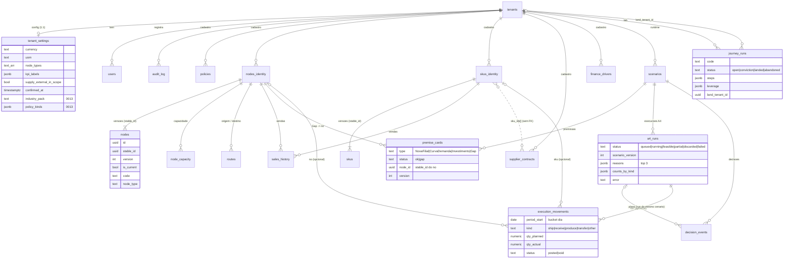

# Modelo de dados — IBP Agentic / Domain Rewire (V0, até migration 0018 · W7 + T-DM High 1+2)

> 🧭 **Versão navegável (diagramas Mermaid + mostrar/ocultar PK/FK):** [data-model.html](./data-model.html)

> **Pra quem:** Felipe (PO / orquestrador). Linguagem simples, com os nomes técnicos entre `crases` pra conversar com a Devi e o Qualidade.
> **Fonte da verdade:** `contracts/v0-postgres-cadastro.sql` (baseline “0001”) + `db/migrations/0002…0018` + `contracts/*.schema.json` + contratos `W4`…`W7` (`docs/architecture/`). Se este doc e o SQL divergirem, **vale o SQL**.
> **Autor:** Deivid (Arquiteto) · 2026-10-30.
> **Sync:** 2026-10-31 ~17:20 America/Sao_Paulo — **0018** T-DM-PERIOD-GRAIN + T-DM-SALESHIST-UQ em `sales_history` (CHECK `period` só `YYYY-MM` + CHECK `qty >= 0` + UNIQUE `(tenant_id, node_id, sku_id, period, source)`; zod `ym`; reimport → 409; sem backfill — Devi; **review Deivid OK**; **aplicada no Neon prod** 2026-10-31 17:09 America/Sao_Paulo via build Vercel `dpl_87QxbREJhZdskjfUoLSzZ3gSgwAm`, 3/3 constraints em `pg_constraint`, 34 linhas). Anterior ~12:15: + nota A1 `CurvaDemanda` (`a1.curva.v1`, contrato `A1-CURVA-DEMANDA-CONTRACT.md`); DDL inalterado (0017). HTML/Page hub atualizados na mesma leva.

---

## 0. Resumo em 30 segundos

- O banco é **um Postgres só, compartilhado por vários clientes (tenants)**. Cada linha tem `tenant_id` e o próprio banco esconde as linhas dos outros clientes (RLS).
- Há dois grupos de tabelas:
  1. **Cadastro (master data):** políticas, nós (filiais/CDs/plantas), capacidade, rotas, SKUs, contratos de fornecedor, histórico de vendas, drivers financeiros. Tudo **versionado**: editar cria uma versão nova, nunca apaga a antiga.
  2. **Runtime (o “jogo” do planejamento):** cenários, cartões de premissa, execuções do otimizador A4, decisões (aprovar/escalar), **movimentos de execução** (0014) e **journeys D3** (0015).
- **Configuração do cliente** (moeda, unidade, rótulos, escopo, “cadastro confirmado”) fica em `tenant_settings`.
- **Duas funções `SECURITY DEFINER`** (0016/0017) são as únicas portas que cruzam tenant — só para o *land* da journey. Fora isso, nenhum SELECT cross-tenant.
- **Export do plano aprovado** (W7) é só leitura + `audit_log`; **sem migration** e sem write-back.
- **Novo cenário só destrava** quando o cliente confirmou o cadastro **e** a prontidão do A4 não está “bloqueada”.

---

## 1. Multi-tenant: como um cliente nunca vê o dado do outro

| Conceito | O que é | Na prática |
|---|---|---|
| `tenants` | Tabela de clientes (`id`, `slug`, `name`). | Um registro por empresa cliente. |
| `tenant_id` | Coluna presente em **toda** tabela de negócio. | Diz “essa linha é do cliente X”. |
| Header `x-tenant-id` | Toda chamada à API manda o id do cliente no cabeçalho (obrigatório; sem ele → `401`). | Hoje é um **stub**: login real (Clerk/Auth.js/Supabase) entra numa wave futura e vai preencher o mesmo campo. |
| Header `x-user-id` | Quem está agindo. Obrigatório para **escrita**. | Vira `created_by` e o “ator” no `audit_log`. |
| `app.tenant_id` | A API abre uma transação por request e grava o tenant numa variável de sessão do Postgres (`set_config`). A função `app_tenant_id()` lê esse valor. | É assim que o banco “sabe” quem está perguntando. |
| **RLS** (Row Level Security) | Regra em cada tabela: `tenant_id = app_tenant_id()` para ler **e** para gravar. | O isolamento é **do banco**, não depende de a aplicação lembrar de filtrar. |
| **FORCE RLS** | Faz a regra valer até para o dono da tabela. | Aplicado em `tenants`/`users`/`audit_log` + cadastro (0002), `tenant_settings` (0003), tabelas de identidade (0006), `premise_cards` (0007), `a4_runs` e `scenarios` (0009), `decision_events` (0012), `execution_movements` (0014), `journey_runs` (0015). **Toda tabela de negócio tem FORCE RLS.** |
| Role `ibp_app` | Usuário de banco que a API usa: **sem superusuário, sem bypass de RLS** (NOBYPASSRLS, 0004), e só com as permissões mínimas. **Não tem INSERT em `tenants`/`users`.** | Mesmo com bug na API, o banco não entrega dado de outro cliente. |

### 1.1 Funções `SECURITY DEFINER` (únicas portas cross-tenant · W5/W6)

Padrão comum: `SET search_path = public, pg_temp`; `REVOKE ALL … FROM PUBLIC` + `GRANT EXECUTE` **só** a `ibp_app`; exigem `app.tenant_id` (senão `insufficient_privilege`); só agem sobre uma journey do tenant corrente (lab) em `status='conviction'` e `land_tenant_id IS NULL`, com `FOR UPDATE`.

| Função | Migration | Faz | Detalhe RLS |
|---|---|---|---|
| `journey_land_tenant(p_run_id, p_slug, p_name) → (tenant_id, admin_user_id)` | 0015, **reescrita na 0016** | *Land thin*: cria 1 tenant + 1 usuário `admin` (`admin@<slug>.local`). Nada mais (settings/pack são gravados depois pelo app sob RLS do tenant novo). | 0016: gera o id antes, `set_config('app.tenant_id', novo, true)` antes dos INSERTs e **restaura o lab** no fim — não depende mais do owner BYPASSRLS. Slug `^[a-z0-9][a-z0-9-]{1,62}$`, nome 1–120; slug duplicado → `unique_violation` (API `409 land_code_exists`). |
| `journey_land_link(p_run_id, p_target, p_actor) → boolean` | 0017 | *Land link*: `true` ⇔ o **mesmo e-mail** do ator do lab é `admin` no tenant alvo (case-insensitive). `false` uniforme para inexistente / sem vínculo / não-admin / alvo = lab (motivo **não** sai da função → sem oráculo de existência). | Lê `users` do alvo com `set_config('app.tenant_id', alvo, true)` só durante a leitura e restaura o lab. Sem tabela/coluna/grant novo. |

**Defesa extra — FK composta por tenant:** chave estrangeira comum não olha RLS. Por isso as referências importantes usam **(tenant_id, id)** juntos — um cartão do cliente A fisicamente não consegue apontar para um nó ou cenário do cliente B (o banco recusa; a API devolve `400 invalid_reference`).

---

## 2. Cadastro (master data) e versionamento

### 2.1 Como funciona a versão (o ponto mais importante)

Cada objeto de cadastro tem três “identidades”:

| Campo | Significado | Analogia |
|---|---|---|
| `id` | Id **daquela versão** (uma linha). | “A edição 3 do documento.” |
| `stable_id` (0006) | Id **do objeto ao longo do tempo**; todas as versões compartilham. Na v1, `stable_id = id`. | “O documento, qualquer que seja a edição.” |
| `version` + `is_current` | Número da versão e se é a vigente. O banco garante **no máximo 1 versão corrente por `stable_id`** (índice único parcial). | “Edição vigente.” |

- **Editar** (`PATCH`, com `why` obrigatório) = cria uma linha nova com o mesmo `stable_id`, `version + 1`, e a anterior deixa de ser corrente.
- **Aposentar** (`DELETE`, com `why`) = nenhuma versão fica corrente. Nada é apagado de fato.
- **Referências entre objetos usam `stable_id`, não o `id` da versão.** Por isso renomear um nó não “quebra” a capacidade, as rotas ou as vendas ligadas a ele.
- Referenciar algo **sem versão corrente** (aposentado) ou o id de uma versão específica → `400 invalid_reference`.

**Tabelas de identidade** (`*_identity`, 0006): existem para os objetos que são alvo de FK — hoje só **`nodes_identity`** e **`skus_identity`**, chave `(tenant_id, stable_id)`. São preenchidas automaticamente (trigger) quando nasce a 1ª versão. É contra elas que as FKs compostas apontam.

### 2.2 Entidades de cadastro

Todas têm `tenant_id`, `id`, `stable_id`, `version`, `is_current`, `created_at`.

| Tabela | O que representa | Campos que importam | Referências |
|---|---|---|---|
| `policies` | Políticas do negócio: estoque, capital de giro, nível de serviço, alçadas… | `kind` (texto livre desde 0005), `name`, `body` (JSON: cobertura, min/max, OTIF, DSI, alçadas, pesos do A4) | `created_by` → `users` |
| `nodes` | Pontos da rede: filial, CD, planta… | `code` (ex.: FL-CPS), `name`, `node_type` (texto livre; validado contra `tenant_settings.node_types` se a lista existir), `attrs` (geo, calendário) | identidade em `nodes_identity` |
| `node_capacity` | Capacidade de um nó (**separada do nó**, com versão própria). | `capacity_t_month` (na API: `capacity_per_period`), `capacity_extra`, `calendar` (indisponibilidades) | `node_id` = **stable_id do nó** → `nodes_identity` |
| `routes` | Ligações logísticas entre dois nós. | `code` (R-14), `mode`, `lead_time_days`, `cost_per_ton` (na API: `cost_per_unit`), `windows` (janelas de entrega) | `origin_node_id`, `dest_node_id` = stable_id → `nodes_identity` |
| `skus` | Produtos. | `code`, `name`, `family`, `unit_cost`, `attrs` | identidade em `skus_identity` |
| `supplier_contracts` | Contratos de fornecedor. | `code`, `supplier_group`, `obligations` (volume mínimo/máximo, take-or-pay, janelas, penalidades), `valid_from/valid_to` | `sku_ids[]` = lista de stable_ids de SKU (**sem FK no banco** — validação só na API) |
| `sales_history` | Histórico de vendas importado (**não versionado**; é dado de ingestão). | `period` (**só `YYYY-MM`** — CHECK `sales_history_period_ym` + zod `ym`, 0018), `qty` (**≥ 0** — CHECK `sales_history_qty_nonneg`), `revenue`, `source` (default `extract`) · **UNIQUE** `(tenant_id, node_id, sku_id, period, source)` (`sales_history_tenant_node_sku_period_source_key`, 0018) | `node_id` → `nodes_identity`, `sku_id` → `skus_identity` |
| `finance_drivers` | Mapa de como volume/preço/prazo/investimento viram caixa, margem, DIO. | `mapping` (JSON) | — |

Tabelas de apoio:

| Tabela | Papel |
|---|---|
| `users` | Usuários do tenant (`email` único por tenant, `role` ∈ domain_owner, sales, supply, finance, admin). Hoje o app só lê. |
| `audit_log` | Trilha de auditoria **append-only**: toda escrita grava ator, ação, entidade e o `why`. `action` é texto livre (sem CHECK); valores em uso no código: `create`, `update`, `retire`, `delete`, `ingest`, `ditado`, `approve`/`escalate`, `void` (W4), `export` (W7). Journey grava `update` em `journey_runs` com `payload.action` ∈ `step_done|snapshot|conviction|land` e `create` em `tenants` no land thin. |

> **`sales_history` · T-DM High 1+2 (0018, V0 opção A):** `period` só mês `YYYY-MM` (`^[0-9]{4}-(0[1-9]|1[0-2])$`, idêntico no CHECK e no zod `ym` de `src/domain/entities.ts`) — `YYYY-MM-DD`/vazio/`2026-13` → `400 validation_failed`. `qty >= 0` (0 ok; negativo → 400). UNIQUE `(tenant_id, node_id, sku_id, period, source)` por tenant (RLS): reimport da mesma chave → **409 `conflict`** (strict, sem upsert V0); batch `{rows:[…]}` é all-or-nothing (1 linha inválida/duplicada → nada gravado). Filtro `GET ?period_from/period_to` aceita só `YYYY-MM` (400 caso contrário) e compara **lexicograficamente** (≡ cronológico nesse formato, sem cast date). A1 mantém `left(period,7)` (inócuo). Sem backfill (audit prod pré-migrate: `PERIOD_LEN_NE_7=0`, `DUP_GROUPS=0`). V1: `period_start date` + `grain`.

> **Agnóstico de indústria (0003/0005):** não há vocabulário de vertical cravado no banco. Tipos de nó, unidades, moeda e rótulos de KPI são **configuração do tenant**. Os nomes legados `capacity_t_month` / `cost_per_ton` ficam no SQL até a W0.2; a API já expõe os nomes neutros.

---

## 3. `tenant_settings` — configuração do cliente (1 linha por tenant)

| Campo | Migration | Para que serve |
|---|---|---|
| `currency` | 0003 | Moeda (ISO 4217). `null` = não definida. |
| `uom` | 0003 | Unidade padrão de volume/capacidade. |
| `node_types[]` | 0003 | Rótulos de tipo de nó aceitos (lista vazia = qualquer texto). |
| `kpi_labels` | 0003 | Como cada KPI aparece na tela (`{"chave": "rótulo"}`), ex.: nome que o cliente usa para capital de giro. |
| `supply_external_in_scope` | 0008 | “Compramos de terceiros?” Default **false**. Quando `true`, **contrato de fornecedor passa a ser exigido** na prontidão do A4; quando `false`, esse item aparece como `n/a`. |
| `confirmed_at` | 0010 | Momento em que o cliente **confirmou o cadastro** para começar cenários. `null` = não confirmado. Gravado **só pelo servidor** (`PUT /api/tenant-settings {confirmed: true}` → agora; `{confirmed: false}` → `null`). Mandar a data direto → `400`. |
| `industry_pack` | 0013 | Pack de indústria (`generic|oilgas|cpg|retail|generic_no_alcada`). `NULL` ≡ **generic** (fail-closed). Troca só via `POST /api/cadastro/pack`. |
| `entity_labels` | 0013 | jsonb labels de entidade (seed do pack + overrides). |
| `policy_kinds` | 0013 | jsonb aliases canônicos; **pack inclui alçada** ≡ chave `alcada` presente. |
| `agent_roster` | 0013 | jsonb A1–A7 (exibição V0; não liga endpoints). |

Constraints 0013: `tenant_settings_pack_nonempty` (`industry_pack` NULL ou não vazio) e `tenant_settings_jsonb_objects` (os três jsonb são objetos). Sem enum de pack no banco (API valida contra `packs/`); sem grant novo.

**F-1 / W6:** prontidão e `paramsFrom` do A4 leem `policy_kinds` sob RLS (`{}` ≡ legado `LEGACY_POLICY_KINDS`, que inclui `alcada`). Política com `kind` fora do vocabulário **não** alimenta o A4 e gera warn `policy_kind_unknown` (W6, §7) — nunca block.

API Cadastro write (Task 9): `GET/POST` packs · `PUT /api/cadastro/alcada` · modos alçada `out_of_pack|no_policy|misconfigured|active`.

---

## 4. Runtime: cenários, premissas, A4, decisões, execução, journey e export

### 4.1 `scenarios`
Um cenário de planejamento (ex.: SCN-0142), versionado (`code` + `version` + `is_current`).
- `leg` ∈ `sales | supply | finance | composed` (de qual perna do IBP veio).
- `status` ∈ `draft | ready | stale | archived`.
- Desde a **0011** (Task 6): app tem `SELECT/INSERT/UPDATE` em `scenarios` (FORCE RLS da 0009). API: `POST/GET /api/scenarios`, ditado mockável, cards aninhados — ver `W2-WIZARD-API-CONTRACT.md`.

### 4.2 `premise_cards` — cartões de premissa
Premissas tipadas do cenário: API + ditado (`source=ditado`, LLM mockável).
- `type` ∈ **`NovaFilial` | `CurvaDemanda` | `Investimento` | `Gap`**.
- `status` ∈ `ok | gap`; `source` ∈ `ditado | edit`; `fields` = JSON livre validado na aplicação; `version` sobe a cada edição.
- **Regra do Gap:** cartão `Gap` **precisa** apontar para um nó (`CHECK` no banco). Desde a 0007, `node_id` guarda o **`stable_id` de um nó com versão corrente** (no JSON do contrato aparece como `links.nodeId`). Versão específica, nó aposentado ou nó de outro tenant → `400 invalid_reference`.
- FKs compostas: `(tenant_id, node_id)` → `nodes_identity`; `(tenant_id, scenario_id)` → `scenarios`.
- Gap aberto (`status = gap`) deixa a prontidão do A4 em **`warn`**.

### 4.3 `a4_runs` — execuções do otimizador A4
Cada vez que o A4 (solver CBC open-source, sem LLM) roda sobre um cenário.
- **Status no banco** (0009): `queued → running → feasible | partial | failed`, e `discarded` (run invalidado porque o cenário mudou de versão).
- **Na API** isso aparece simplificado: `status = done` + `outcome = feasible` (atende tudo) ou `partial` (sobrou demanda não atendida); ou `failed` com `error` curto (ex.: `timeout`).
- `scenario_version`: “fotografia” da versão do cenário usada no run — se a premissa muda, o run antigo deixa de valer.
- `reasons`: as **até 3** principais explicações (contrato `a4-reason.schema.json`): `kind` ∈ **`janela | capacidade | contrato | custo | outro`**, `severity` ∈ `info | warn | block`, `summary` e `refs` (nó/SKU/rota/período).
- `counts_by_kind`: contagem de todas as razões por kind (contrato `a4-run-summary.schema.json`).
- `plan`: plano resumido (fluxos, atendimento local, falta, utilização).
- `run_code` único por tenant; FK composta `(tenant_id, scenario_id)` → `scenarios`.
- **0012** adiciona `UNIQUE (tenant_id, id, scenario_id)` — alvo das FKs de `decision_events` e `execution_movements` (garante “run do **mesmo** cenário”).
- `plan` = `PlanOut` (`objective`, `solverStatus`, `wallMs`, `period`, `totals`, `flows[]`, `local[]`, `unmet[]`, `utilization[]` + `params`, `reasonCandidates`) — é o que o export W7 entrega cru (§4.7).
- Rodar exige prontidão **≠ block** (senão `409 a4_not_ready`).

### 4.4 `decision_events` — aprovar / escalar
**Task 7 / 0012:** API `POST/GET /api/decision-events` (+ `/:id`); app com **GRANT SELECT+INSERT** (append-only — sem UPDATE/DELETE); **FORCE RLS**; FKs compostas `(tenant_id, scenario_id)` → `scenarios` e `(tenant_id, run_id, scenario_id)` → `a4_runs` (run do **mesmo** cenário; `run_id` NULL não checa).
- `action` ∈ `approve | escalate`; `why` **sempre** obrigatório (não vazio; API pede ≥20 chars se o run tiver warn/block/partial); `actor_role` ∈ CHECK `domain_owner|sales|supply|finance|system`; `actor_user_id`; `scenario_id` + `scenario_version`; `run_id` opcional.
- Stale (`scenario_version` ≠ corrente): **bloqueia approve** (`409`); escalate segue.
- Role `admin` do header → `actor_role=domain_owner` na decisão (audit pode guardar role real à parte).
- `export_ref` / `exportRef`: **sempre null** na V0. O export W7 (§4.7) **não** preenche essa coluna — a única escrita dele é `audit_log`.
- Índices 0012: `decision_events_scenario_idx (tenant_id, scenario_id, at)` e `decision_events_run_idx (tenant_id, run_id) WHERE run_id IS NOT NULL`.
- Schema JSON **v0.2**: campos **opcionais** `impactMi`/`alcadaMi`/`escalateTo` (bump 2026-10-30; persistência na API = Task 8).
- **Sem write-back:** “aprovar” = registrar a decisão (+ export W7), nunca escrever no ERP.

### 4.5 `execution_movements` — execução programada/realizada (W4 · Task 10 · 0014)
Movimentos ligados a um plano (`a4_runs`), base do Pulse “programado vs plano” e da fonte `execution` de exceções. Contrato: `W4-EXECUTION-PULSE-WRITE-CONTRACT.md` · schema `contracts/execution-movement.schema.json`.
- Colunas: `plan_run_id` + `scenario_id` + `scenario_version` (obrigatórios), `period_start` **date** (bucket = **dia**), `kind` ∈ `ship|receive|produce|transfer|other`, `node_id`/`sku_id` (stable_ids, opcionais), `qty_planned` (≥0, null ok), `qty_actual` (≥0, obrigatório), `uom`, `status` ∈ `posted|void` (default `posted`), `source` ∈ `api|seed|import` (default `api`), `note`, `at`, `actor_user_id` → `users`, `actor_role` (texto, **sem CHECK**). `UNIQUE (tenant_id, id)`.
- FKs compostas: `(tenant_id, plan_run_id, scenario_id)` → `a4_runs (tenant_id, id, scenario_id)`; `(tenant_id, node_id)` → `nodes_identity`; `(tenant_id, sku_id)` → `skus_identity` (MATCH SIMPLE: NULL não checa).
- RLS + **FORCE** (`tenant_isolation_execution`). Índice `(tenant_id, plan_run_id, period_start)`.
- **Append-only de fato:** app tem `SELECT, INSERT` + `UPDATE (status)` só; trigger `execution_movements_void_only` aceita **apenas** `posted → void` sem mudar nenhuma outra coluna; sem DELETE.
- Regras API (contrato): batch até 100, **all-or-nothing**; exceção quando `|actual−planned|/planned > 0.15` (15% exato = quiet) → `warn`; planned>0 e actual=0 → `block`; sem movimentos → `adherence = null` (`no_data`). Sem tabela de alertas: exceções são projeção.

### 4.6 `journey_runs` — learning journey D3 (W5 · Task 11 · 0015; W6 · Task 12)
Journey vive no **tenant lab** (RLS normal). Contratos: `W5-JOURNEY-D3-CONTRACT.md`, `W6-LAND-HARDEN-KIND-WARN-CONTRACT.md`.
- Colunas: `code` (único por tenant), `status` ∈ `open|conviction|landed|abandoned` (default `open`; `abandoned` reservado — sem endpoint), `sponsor_role` (texto, **sem CHECK**), `scope` jsonb (`{bu?, nodeStableIds[], skuFamilies[]}` — registrado, **sem filtro** na V0), `steps` jsonb (`[{id,status,at,notes}]`), `leverage` jsonb (snapshot; `null` + `nullReason` quando sem plano), `conviction_ref` (path do pack JSON+MD em disco), `land_tenant_id` → `tenants` (FK **simples**: cross-ref só id), `created_at`, `updated_at` (gravado pelo app; sem trigger). `UNIQUE (tenant_id, code)`, `UNIQUE (tenant_id, id)`; índice `(tenant_id, status)`.
- RLS + **FORCE** (`tenant_isolation_journey`). App: `SELECT, INSERT, UPDATE` — **sem DELETE** (abandon = status).
- Steps fixos, ordem **forçada (W6)**: `leverage → consensus → roles → conviction`; fora de ordem → `409 steps_out_of_order {stepId, requires, missing}` (regra de app, sem migration).
- **Land** (`POST /api/journey/runs/:id/land`): papel `ctx.role ∈ {admin, domain_owner}` (W6) senão `403 forbidden_role`. Sem `landTenantId` → `journey_land_tenant()` (thin, §1.1); com `landTenantId` → `journey_land_link()`; `false` → `400 invalid_reference` byte-igual. Land ≠ write-back; não copia execução.

### 4.7 Export do plano aprovado (W7 · Task 13 · **sem migration**)
`GET /api/plans/approved/export?format=json|csv` — contrato `W7-PLAN-EXPORT-CONTRACT.md` · schema `contracts/plan-export.schema.json`.
- **Nenhuma tabela, coluna, função ou grant novo.** Lê `a4_runs` / `decision_events` / `scenarios` / `tenant_settings` (SELECT já concedido) e grava **1 linha** `audit_log` (`action='export'`, `entity='a4_runs'`, `entity_id=runId`, payload `{format, planRef}`) só no 200.
- Só `planRef.basis = approved` (senão `409 no_approved_plan`); papéis `admin|domain_owner|finance` (senão `403 forbidden_role`). Números = `a4_runs.plan` cru menos `reasonCandidates`.
- Sem arquivo em disco, sem SECURITY DEFINER, sem SELECT cross-tenant (FORCE RLS de `a4_runs`).

### 4.8 Papéis exigidos por operação (regra de app sobre `users.role`, headers stub)
| Operação | Papéis | Fonte |
|---|---|---|
| Land journey (thin e link) | `admin`, `domain_owner` | W6 cravo 1 |
| Export plano aprovado | `admin`, `domain_owner`, `finance` | W7 cravo 3 |
| `decision_events.actor_role` | CHECK no banco `domain_owner|sales|supply|finance|system` (`admin` → `domain_owner`) | 0012 |

---

## 5. Mapa das chaves (quem aponta pra quem)

| De | Para | Tipo |
|---|---|---|
| Todas as tabelas de negócio `.tenant_id` | `tenants.id` | FK simples + RLS |
| `nodes (tenant_id, stable_id)` | `nodes_identity` | FK composta (0006) |
| `skus (tenant_id, stable_id)` | `skus_identity` | FK composta (0006) |
| `node_capacity (tenant_id, node_id)` | `nodes_identity` | FK composta (0006) |
| `routes (tenant_id, origin_node_id)` e `(tenant_id, dest_node_id)` | `nodes_identity` | FK composta (0006) |
| `sales_history (tenant_id, node_id)` / `(tenant_id, sku_id)` | `nodes_identity` / `skus_identity` | FK composta (0006) |
| `supplier_contracts.sku_ids[]` | stable_ids de SKU | **sem FK** (só API) |
| `premise_cards (tenant_id, node_id)` | `nodes_identity` | FK composta (0007) |
| `premise_cards (tenant_id, scenario_id)` | `scenarios (tenant_id, id)` | FK composta (0007) |
| `a4_runs (tenant_id, scenario_id)` | `scenarios (tenant_id, id)` | FK composta (0009) |
| `decision_events (tenant_id, scenario_id)` | `scenarios (tenant_id, id)` | FK composta (0012) |
| `decision_events (tenant_id, run_id, scenario_id)` | `a4_runs (tenant_id, id, scenario_id)` | FK composta (0012; run_id NULL ok) |
| `execution_movements (tenant_id, plan_run_id, scenario_id)` | `a4_runs (tenant_id, id, scenario_id)` | FK composta (0014) |
| `execution_movements (tenant_id, node_id)` / `(tenant_id, sku_id)` | `nodes_identity` / `skus_identity` | FK composta (0014; NULL ok) |
| `journey_runs.land_tenant_id` | `tenants.id` | FK simples (0015; cross-ref de outro tenant por design) |
| `policies.created_by`, `scenarios.created_by`, `decision_events.actor_user_id`, `execution_movements.actor_user_id` | `users.id` | FK simples |
| `tenant_settings.tenant_id` | `tenants.id` | PK = FK (1 linha por tenant) |

---

## 6. Diagrama (simplificado)

---

## 7. O que significa “destravar Novo cenário”

**Regra:** `tenant_settings.confirmed_at IS NOT NULL` **E** prontidão do A4 `state ≠ block`.

Em português: *o cliente disse “meu cadastro está pronto”* **e** *o cadastro tem o mínimo para o otimizador rodar*.

A **prontidão** (`GET /api/a4-readiness`) é calculada na hora, olhando só versões correntes:

| Item | Exigido quando | “ok” se… |
|---|---|---|
| Política | sempre | existe política corrente de capital de giro, **ou** de estoque **+** serviço — grupos de `kind` vindos de `tenant_settings.policy_kinds` (F-1; `{}` → legado `POLICY_KINDS`) |
| Capacidade | sempre | algum nó corrente tem `node_capacity` corrente com capacidade > 0 (capacidade **não** vem do campo do nó) |
| Rota | sempre | existe rota corrente |
| Contrato de fornecedor | só com `supply_external_in_scope = true` | existe contrato corrente (senão aparece `n/a`) |

- `block` = falta algum item exigido · `warn` = tudo ok, mas há nó sem capacidade, Gap aberto ou **política com kind fora do vocabulário** (`policy_kind_unknown`, W6 — `by[]` = stable_ids, `why` explicando que não alimenta o A4) · `ok` = limpo. `policy_kind_unknown` **nunca** vira `block`; `POST/PATCH /api/policies` devolvem o mesmo warn no body (201/200).
- `confirmed_at` **não** entra no `state` — são coisas separadas. A API devolve um campo de ajuda `unlock.new_scenario = confirmado && state ≠ block` para a UI (wire v0.3.2 da Didi).
- **Task 6 enforce:** `POST /api/scenarios` exige `confirmed_at` (senão `403 scenario_locked`) e prontidão ≠ `block` (senão `409 a4_not_ready`).
- Limitação conhecida: confirmar **não** é desfeito automaticamente se o cadastro mudar depois.

---

## 8. Fora do V0 (de propósito)

| Fora | Por quê / quando |
|---|---|
| ~~Criar cenário / ditado~~ | **feito (Task 6)** — grant 0011 + `/api/scenarios` + ditado mock |
| ~~Gravar `decision_events` (aprovar/escalar)~~ | **feito (Task 7)** — 0012 + `/api/decision-events`; `exportRef` null V0 |
| ~~Bump DecisionEvent + Pulse/Visões~~ | **feito (Task 8)** — GETs W3; v0.2 no `audit_log.payload` (sem colunas) |
| ~~Alçada Finance, Pulse com fila~~ | **feito (W3/W3b)** — fila de alçada GET + `PUT /api/cadastro/alcada` |
| ~~Execução programada/realizada~~ | **feito (W4 / 0014)** — `execution_movements`; import CSV/SFTP segue fora (`source=import` reservado) |
| ~~Journey D3 + land~~ | **feito (W5/W6 / 0015–0017)**; fora: scope filter, endpoint `abandon`, convite cross-tenant sem e-mail igual |
| ~~Export plano aprovado~~ | **feito (W7, sem migration)** — JSON/CSV; fora: XLSX/PDF, `latest_run`, `?runId=`, HEAD (residual 405) |
| A7 (narrativa por LLM), A6 agente | waves seguintes (LLM zero até lá) |
| **Write-back** no ERP / sistemas do cliente | fora do V0 por princípio: aprovar = registrar + exportar (W7 = arquivo que o usuário leva) |
| Login real + RBAC | headers são stub; auth real numa wave seguinte |
| ~~Lista de `policy_kinds` por tenant~~ | **feito (Task 9 / 0013)** — + pack + alçada write |
| Rename das colunas legadas (`capacity_t_month`, `cost_per_ton`) | W0.2 (API já usa nomes neutros) |
| FK de `supplier_contracts.sku_ids[]` | array sem FK; validação na API |
| Tabelas de identidade para políticas, rotas, contratos etc. | só `nodes`/`skus` são alvo de FK hoje; criar quando alguém precisar referenciá-los |
| Estoque/capital de giro **dentro** do solver, multi-período, multi-escalão | A4 piloto: 1 período, 1 escalão |
| Gurobi/CPLEX, segredos/API keys no banco | proibidos pelo gate e pelas guidelines de segurança |

---

---

## 9. Gaps conhecidos do modelo (backlog arch — nada disso é schema novo ainda)

| Gap | Onde | Nota |
|---|---|---|
| `actor_role` sem CHECK | `execution_movements` (0014) | `decision_events` tem CHECK (0012); alinhar enum se o PO quiser. |
| `sponsor_role` sem CHECK | `journey_runs` (0015) | Texto livre hoje. |
| `audit_log.action` sem CHECK | baseline | Vocabulário só no código (§2.2). |
| `journey_runs.updated_at` sem trigger | 0015 | App grava `now()` no UPDATE. |
| `journey_runs.scope` sem efeito | W5/W6 | Registrado, `scopeFilter: tenant_v0`. |
| `export_ref` sempre null | `decision_events` | W7 não persiste referência; só `audit_log`. |
| `policies.kind` sem FK/CHECK contra `policy_kinds` | 0005/0013 | Por desenho: só warn (W6). |
| Onboarding base→SKU→política (Felipe 30/10) | readiness A4 | Readiness hoje não exige SKU; se o pacote UX virar gate de prontidão → revisar contrato antes de schema. |

---

*Referências:* `contracts/README.md`, `README.md` (API), `docs/architecture/W1-A4-SKELETON.md`, `W1C-OR-TOOLS-DESIGN.md`, `W2-WIZARD-API-CONTRACT.md`, `W3B-CADASTRO-WRITE-API-CONTRACT.md`, `W4-EXECUTION-PULSE-WRITE-CONTRACT.md`, `W5-JOURNEY-D3-CONTRACT.md`, `W6-LAND-HARDEN-KIND-WARN-CONTRACT.md`, `W7-PLAN-EXPORT-CONTRACT.md`, `SECURITY-GUIDELINES.md`.
